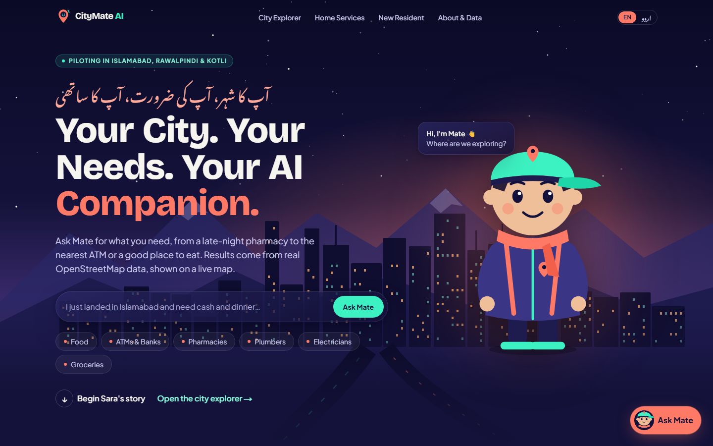
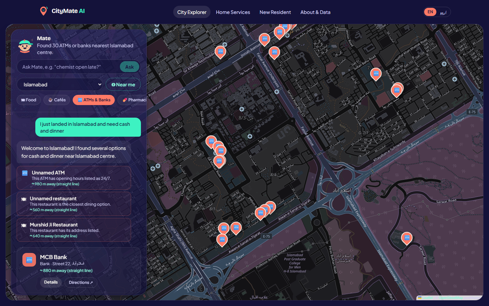
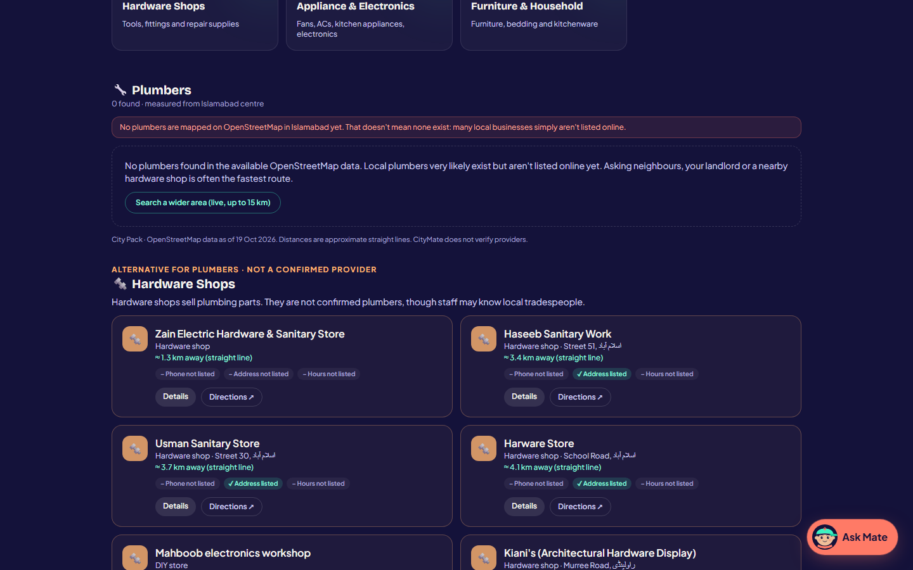
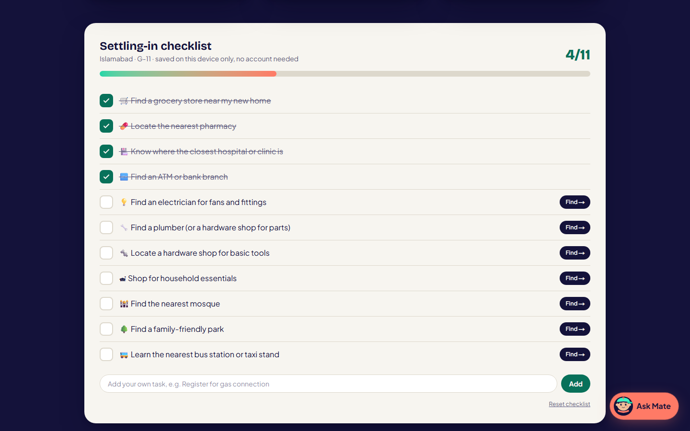
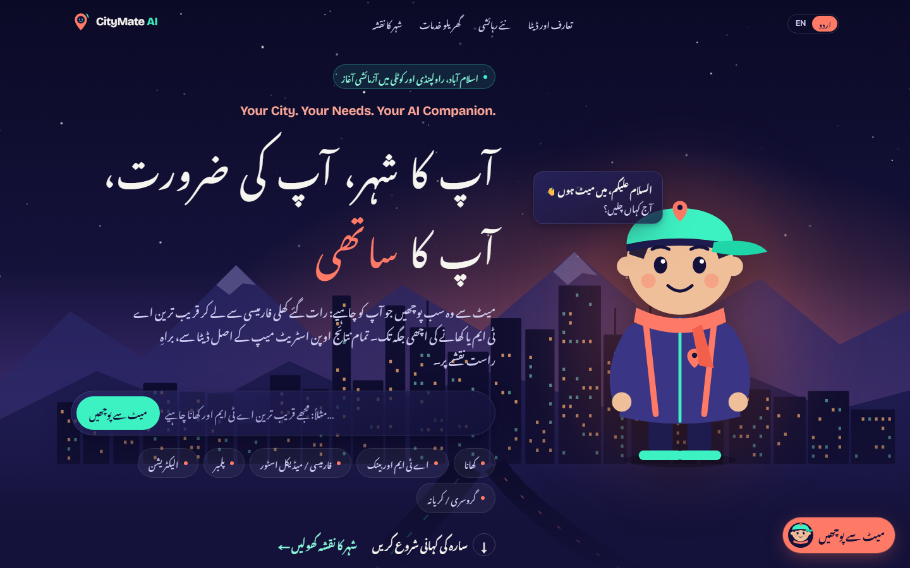
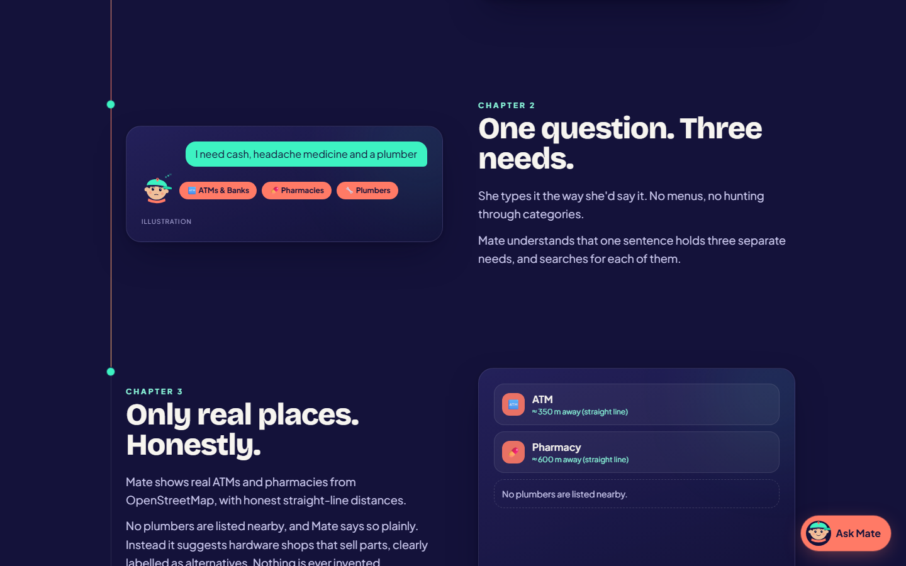
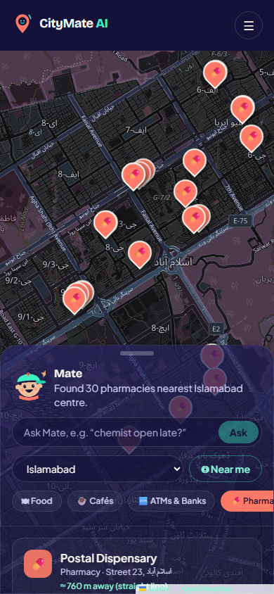
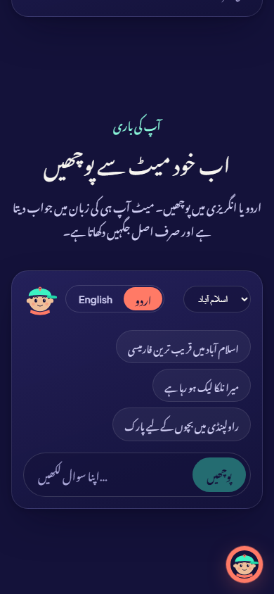
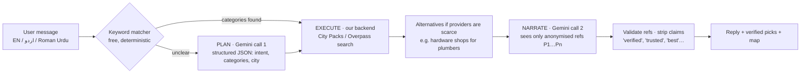

# CityMate AI

**Your City. Your Needs. Your AI Companion.** · آپ کا شہر، آپ کی ضرورت، آپ کا ساتھی

CityMate AI is an AI daily-life assistant for travellers, visitors and people who have just moved to a new city in Pakistan. It works out what you need, even when you describe a problem in English or Urdu, then finds real nearby places and services from open map data. It is honest about what it doesn't know.

🌐 **Live app:** https://citymate-ai.vercel.app
🏙️ **Pilot cities:** Islamabad · Rawalpindi · Kotli (AJK)
💸 **Cost to run:** free (Vercel Hobby, Gemini free tier, OpenStreetMap). Non-commercial prototype.



---

## 1. Problem statement and solution

### The problem
Arriving in an unfamiliar city, whether as a traveller, a student or a family that has just moved, raises urgent everyday questions:

- *"Where's an ATM and somewhere to eat right now?"*
- *"My kitchen tap is leaking. Who can fix it?"*
- *"I've just moved in. Where are the pharmacy, the grocery store and a park for the kids?"*

General map apps expect you to already know **what kind of place** to search for, and they rarely say when their data is missing. Newcomers in Pakistan also often think and type in **Urdu or Roman Urdu**. Listings for local tradespeople such as plumbers and electricians are sparse online, so a naive AI assistant will often **make up** businesses, phone numbers or ratings.

### Our solution
CityMate AI is a **problem-solving companion, not another map clone**:

| Feature | What it does |
|---|---|
| 🧭 **AI City Assistant** | Describe your need in your own words (English, اردو or Roman Urdu). Mate splits it into needs ("cash **and** dinner") and shows real places on a live map. |
| 🔧 **Home Services** | Problem-based search: "AC stopped cooling" → AC technicians. When no providers are listed, Mate says so and offers **clearly labelled alternatives** (e.g. hardware shops that sell parts), never presented as providers. |
| 🏡 **New Resident Assistant** | A welcome flow, essentials grouped by *Home setup / Daily essentials / Family*, and a settling-in checklist saved on the device with no account. |
| 💬 **Ask Mate chatbot** | A floating quick-answer assistant on every page. |
| 🇵🇰 **Urdu mode** | English by default; one tap switches the experience to Urdu (Nastaliq, right-to-left). Mate replies in the user's language. |

**Core principle: grounded honesty.** Every place shown comes from OpenStreetMap through our own backend. The AI never writes place names, phone numbers, ratings or prices. Missing data is reported as missing, and distances are labelled as approximate straight lines.

---

## 2. Product screenshots

| | |
|---|---|
|  **AI City Assistant:** one message, two needs (cash and dinner), real places on the map. |  **Home Services:** no plumbers are listed, so hardware shops are shown, labelled *"not a confirmed provider"*. |
|  **New Resident checklist:** progress saved on the device, "Find →" on every task. |  **Urdu mode:** the full landing experience in Urdu Nastaliq. |
|  **Story-driven landing:** *Sara's first night* explains the product chapter by chapter. |   

**Mobile:** map with bottom sheet; asking Mate in Urdu. |

---

## 3. Technology stack

| Layer | Technology |
|---|---|
| Framework | **Next.js 16** (App Router, Route Handlers, Turbopack), **React 19**, **TypeScript** |
| Styling & motion | **Tailwind CSS 4** ("Night City, Warm Guide" design tokens), **Motion for React**, CSS/SVG animation |
| Maps | **Leaflet** + **React-Leaflet**, OpenStreetMap tiles (night-themed via CSS) |
| AI | **Google Gemini API**, model `gemini-3.5-flash-lite`, via the official `@google/genai` SDK (server-side only) |
| Location data | **OpenStreetMap** via the **Overpass API** + pre-built, attributed **City Packs** (JSON snapshots) |
| Validation | **Zod** (API inputs and AI structured outputs) |
| Fonts | Bricolage Grotesque, Plus Jakarta Sans, Noto Nastaliq Urdu (self-hosted via `next/font`) |
| Testing | **Vitest** (60 unit and API tests) + `scripts/smoke.mjs` end-to-end smoke test |
| Hosting | **Vercel Hobby** (free). No database and no paid services. |

---

## 4. Setup and installation

**Prerequisites:** Node.js **24 LTS**, npm, Git. A free Gemini API key is optional; without it the app runs in AI-off mode.

```bash
git clone https://github.com/MuhammadQutab/citymate-ai.git
cd citymate-ai
npm install
cp .env.example .env.local        # then set GEMINI_API_KEY (free: https://aistudio.google.com/apikey)
npm run dev                       # http://localhost:3000
```

| Script | Purpose |
|---|---|
| `npm run dev` | Development server |
| `npm run build` / `npm start` | Production build / serve |
| `npm test` | Unit and API tests (Vitest; no network needed) |
| `npm run lint` · `npm run typecheck` | ESLint · TypeScript |
| `npm run citypacks [-- <city>]` | Rebuild City Packs from OpenStreetMap (run monthly at most) |
| `npm run smoke -- <url> [--ai]` | End-to-end check of all pages and APIs against any deployment |

**Environment variables**

| Name | Required | Description |
|---|---|---|
| `GEMINI_API_KEY` | No | Enables the AI assistant. Without it, deterministic "basic" mode is used. |
| `GEMINI_MODEL` | No | Overrides the default `gemini-3.5-flash-lite`. |

**Deploy to Vercel:** import the repo, add `GEMINI_API_KEY`, deploy, then run `npm run smoke -- https://<app>.vercel.app --ai`.

---

## 5. AI methodology and implementation

CityMate uses a bounded **Plan → Execute → Narrate** agent ([src/lib/agent/agent.ts](src/lib/agent/agent.ts)). The language model **interprets and explains**; our code **searches**.



1. **Plan:** a free keyword matcher with English, Urdu-script and Roman-Urdu vocabulary (e.g. *nalka → plumber*, *dawai → pharmacy*) handles clear requests with **no model call**. Indirect problems ("water dripping from the ceiling") go to Gemini, which may only choose from our fixed **24-category taxonomy** ([src/lib/places/categories.ts](src/lib/places/categories.ts)).
2. **Execute:** our server searches real data. Supported cities use **City Packs**, and elsewhere a radius-bounded **Overpass** query runs. When real providers are scarce, related categories are added as **clearly labelled alternatives**.
3. **Narrate:** Gemini receives the verified results as anonymous references (`P1`, `P2`…) with only the facts we hold. It may not write names, addresses, phone numbers or distances in its reply; the UI renders those from verified data. Picks referring to unknown references are discarded.
4. **Guardrails:**
   - A deterministic filter removes endorsement words such as *verified, trusted, best* (and Urdu equivalents like *تصدیق شدہ*, *بہترین*), while keeping negations such as "not verified".
   - The agent is tested against prompt injection; for example, "invent five-star hotels" returns only real hotels.
5. **Language:** the reply language is detected from the script or chosen in the UI. Prompts instruct natural Urdu (not Roman Urdu) when needed.
6. **Graceful degradation:** with no key, a quota limit (429), a timeout or invalid output, Mate switches instantly to a deterministic "basic" mode in the same language with an honest notice. A 60-second circuit breaker avoids hammering the API.

---

## 6. AI model names and API usage

| Item | Detail |
|---|---|
| **Model** | `gemini-3.5-flash-lite` (Google Gemini, free tier). Configurable via `GEMINI_MODEL`. |
| **SDK** | `@google/genai` → `ai.models.generateContent()` |
| **Where it runs** | Server only (`/api/chat` Route Handler). The API key is never sent to the browser. |
| **Output format** | `responseMimeType: "application/json"` + `responseJsonSchema` generated from Zod schemas, then re-validated with Zod |
| **Settings** | `temperature: 0.3`, `thinkingLevel: MINIMAL` (low latency), `maxOutputTokens` 200 (plan) / 350 (narrate), 18 s timeout per call |
| **Calls per message** | **0–2** (0 when the answer is cached; the planner is skipped when keywords match) |
| **Quota protection** | Per-instance answer cache for identical context-free questions, per-client rate limits (~10 chats/min), cross-origin request blocking, 60 s cooldown after quota errors |
| **Typical latency** | 1–3 s end to end |

**Other APIs used**

| API | Use |
|---|---|
| **OpenStreetMap Overpass API** | Building City Packs; live searches outside pilot cities (with failover across 3 public instances, caching and fail-fast) |
| **OpenStreetMap tile server** | Map imagery (with attribution) |
| **Browser Geolocation API** | Opt-in "Near me". Coordinates are rounded and never stored. |

**CityMate's own HTTP API** (shared by the web app and future mobile apps; documented in code):

| Endpoint | Purpose |
|---|---|
| `GET /api/categories` | Taxonomy (groups, 24 categories, alternatives) and supported cities |
| `GET /api/places?category=&city=\|lat=&lon=[&limit][&wide=1]` | Nearest real places for one category |
| `GET /api/services?category=…` | Places plus clearly labelled `alternatives` when providers are scarce |
| `POST /api/chat` `{ message, history?, city?, near?, lang? }` | AI City Assistant (Plan → Execute → Narrate) |

Errors always use `{ error, message, issues? }` with 400 / 403 / 429 / 503 status codes.

---

## 7. Team member contributions

| Member | Role | Contributions |
|---|---|---|
| **Muhammad Qutab** ([@MuhammadQutab](https://github.com/MuhammadQutab)) | Solo developer & product owner | Product vision and problem definition; feature requirements (AI City Assistant, Home Services, New Resident Assistant, Urdu experience); creative direction ("Night City, Warm Guide", Mate companion, story landing); testing and acceptance of every phase; deployment. |

**AI-assisted development:** the codebase was built with **Claude Code** as a pair-programming assistant, directed and reviewed by Muhammad Qutab phase by phase.

---

## Project structure

```
src/app/                 pages (/, /explore, /services, /new-resident, /place/[id], /about) + API routes
src/components/          UI: landing/, explore/, services/, resident/, chat/, map/, mate/, places/, layout/
src/content/landing.ts   English + Urdu copy for the landing experience
src/lib/agent/           Gemini client, Plan → Execute → Narrate agent, request/response types
src/lib/places/          taxonomy, cities, normalisation, providers (City Pack / Overpass), search service
src/lib/server/guards.ts rate limiter, TTL cache, circuit breaker
src/data/citypacks/      attributed OpenStreetMap snapshots
scripts/                 City Pack builder, smoke test
```

## Data, privacy & limitations

- Map data © [OpenStreetMap contributors](https://www.openstreetmap.org/copyright), ODbL. Coverage varies: Islamabad has 3,215 mapped places, Rawalpindi 1,463 and Kotli 11. Few tradespeople are listed anywhere, which is why alternatives exist.
- Opening hours and phone numbers are listed for only around 5% of places, and may be outdated.
- There are no accounts and no server-side storage of locations or chats. Checklist and language preferences stay in the browser.
- Rate limits are per serverless instance (best-effort). The hard safety comes from bounded AI usage and graceful fallbacks.
- City illustrations and the Mate character are original artwork. They are decorative and do not depict real locations.
